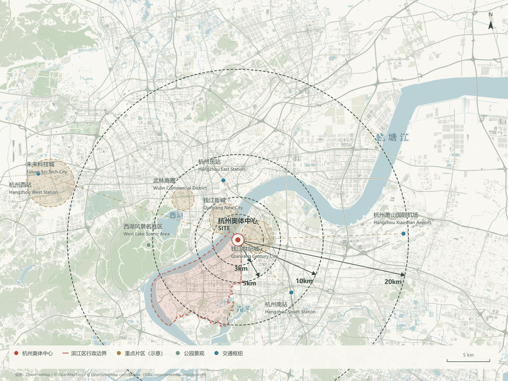
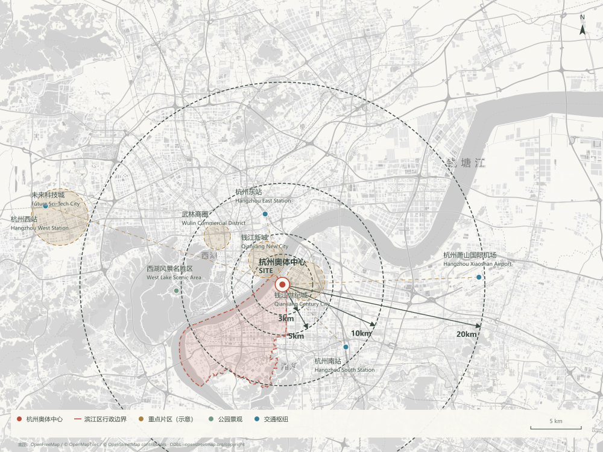
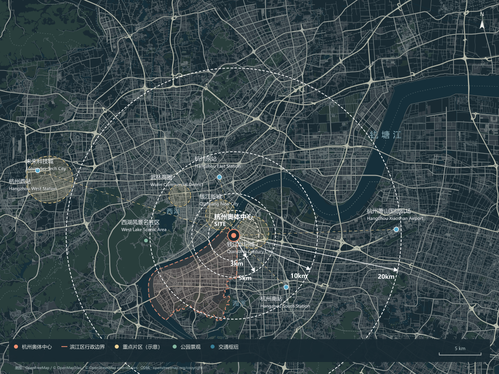

# 场地分析工具 · v0.1.0

简体中文 | [English](README.en.md)

**圈定场地，自动整理周边信息，微调后导出一张建筑分析图。**

面向中国大陆建筑前期设计的本地地图工作台。把搜索定位、城市区位分析、图面风格和手动标注放在一个页面里完成。



*杭州奥体样例 · 苔绿风格。由当前版本的出图代码基于内置测试数据渲染，保留地图署名；示意范围不代表项目实测红线。*

<details>
<summary>查看同一场地的浅色与深色风格</summary>

| 浅色线稿 | 深色线稿 |
|---|---|
|  |  |

同一组数据、同一取景，只切换图面风格。卫星风格需要用户配置地图服务后在线加载，本页未使用卫星截图作为样例。

</details>

## 能做什么

| 功能 | 你可以怎样使用 |
|---|---|
| 搜索与场地确认 | 先搜地址或附近学校，再移动到真实地块圈选；项目名由你自己填写。 |
| 自动周边分析 | 根据城市和出图范围查询交通枢纽、商业中心、公园及公共设施，筛选、分级并排布标注。 |
| 四种图面风格 | 浅色线稿、苔绿、深色线稿、灰度卫星影像叠加分析。 |
| 页面内手动微调 | 拖动和修改名称、隐藏节点，绘制实线、虚线、箭头、区域和文字，支持撤销重做。 |
| 单张高清出图 | 按当前出图框导出 PNG / SVG；默认 PNG 为 4800 × 3600，工具栏不进入图片，地图署名保留。 |
| 项目保存与恢复 | 自动保存在当前浏览器，可下载、导入 JSON 备份，继续调整同一个项目。 |

## 怎么开始使用

需要 **Node.js 22 或 24（附带 npm）＋现代浏览器＋网络＋你自己的高德 Web 端 JS API Key 和配套安全密钥**。工具在你电脑上运行；当前应用界面为中文，英文版提供使用文档。

### 1. 获取项目

在仓库页面点击 **Code → Download ZIP** 并解压，或通过 Git 克隆本仓库。只是使用工具，无需先 Fork。当前仓库为私有，仅已获访问权限的账号可以下载。

### 2. 启动工具：选择一种方式

**使用 AI Agent**：把解压后的项目文件夹交给可操作本地文件和终端的 Agent，并发送：

```text
请读取这个项目的 README.md、SKILL.md 和 AGENTS.md，检查运行环境，
安装锁定依赖，运行测试与环境检查，然后启动本机网页。
地图 Key 和安全密钥由我在网页设置中填写，不要写入代码或上传。
```

**手动启动**：在包含 package.json 的项目目录打开终端，依次执行：

```sh
npm ci
npm test
npm run check
npm start
```

打开 http://127.0.0.1:4173/ ，保持启动服务的终端运行。

### 3. 配置地图

点击页面里的 **地图配置**，填写自己的高德 JS API Key 和匹配的安全密钥。配置保存在本机 `.local/amap.json`，已被 Git 排除。不要把密钥发到聊天、填进源码或提交到仓库。

没有配置时可以打开工作台，但真实搜索、周边查询和卫星影像需要有效凭证及网络。

### 4. 制作第一张分析图

1. **找到并确认设计场地**：搜索参照地点，平移到真实地块，画矩形或多边形，填写项目名并确认边界。搜索附近学校不会把学校名称当作项目名。
2. **确定城市分析范围**：独立调整地图取景和出图比例，再生成周边分析。
3. **选择风格、微调图面**：修改名称、调整文字位置、隐藏节点，按需添加线条和文字。
4. **导出并保存项目**：导出当前出图框内的 PNG / SVG，并下载 JSON 项目备份。

更详细的操作与检查方法见 [工作流与验收](docs/workflow.md)。

## 代码结构与继续开发

```text
serve.mjs              本机服务、配置、地图代理
analysis.mjs           查询编排及分析接口
discovery.mjs          地点筛选、分级、去重
basemap-service.mjs    动态地图范围与图层
dist/                  直接维护的前端源码与底图资产
tests/                 自动化回归测试
vendor/                随包依赖与原许可证
samples/               杭州、良渚测试数据
scripts/               环境检查和本机服务验证
docs/                  使用说明、架构、验证与成果图
SKILL.md               Agent 复用入口
```

**没有额外的前端编译步骤，dist/ 不是可随意删除的构建缓存。** 随包杭州地图数据用于首屏与回归复现；新区域按当前取景联网加载。修改前请阅读 [架构与产品约束](docs/architecture.md) 和 [AGENTS.md](AGENTS.md)。

[Agent 使用说明](SKILL.md) · [验证记录](docs/validation.md) · [版本记录](CHANGELOG.md)

## 当前能力边界

- 自动标注来自地点接口查询与规则筛选，不是从影像推断真实用地边界。设计红线需要用户确认。
- 卫星导出取决于地图图层、网络及浏览器读取权限；跨域失败或超时会报错，不保证任意环境都成功。
- SVG 的底图为内嵌栅格影像，分析与手绘为矢量；不是全矢量地图。
- v0.1.0 在 Windows / Node 24 下通过 62 项自动化测试；这不等同于真实地图和浏览器完整验收。本页样例也不代表重新完成了线上地图验收。
- 这是本机工具，没有账号、云端保存、多人系统、支付或访问统计。上传 GitHub 不等于网页公开上线。

## 许可与地图来源

原创应用未授予公共开源许可，当前仓库用于私有研发保存。第三方依赖、地图数据及影像分别遵循其原有条款，见 [第三方说明](NOTICE.md) 和 [分发说明](docs/distribution.md)。私有上传不代表取得地图服务商业授权。
